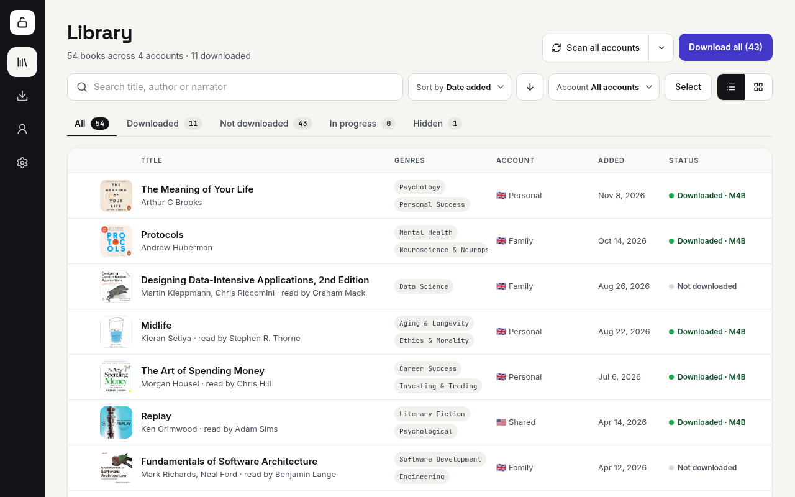
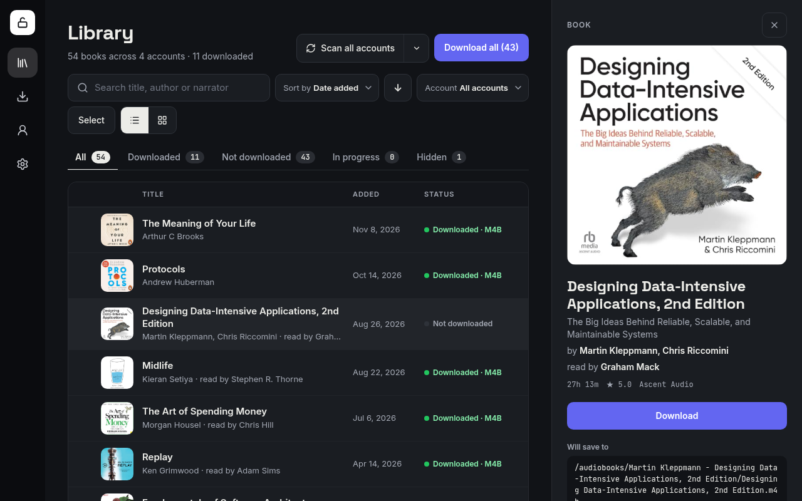

# Libera

A self-hosted web app for managing and backing up your Audible library: scan
your books, download and decrypt them to M4B or MP3 with Audible's real chapter
titles and cover art embedded, and keep them organized for media servers like
Audiobookshelf. Inspired by [Libation](https://github.com/rmcrackan/Libation).

One container: a FastAPI backend that also serves the Vue 3 frontend.





## Features

- **Lossless M4B or MP3:** Decrypts AAXC (with AAX fallback) via `ffmpeg` — stream-copied M4B by default, or re-encoded MP3, with per-book overrides.
- **Real chapter titles & cover art:** Embeds Audible's chapter outline and highest-resolution cover into the audio, and writes `cover.jpg`, `.cue`, and `.chapters.json` alongside it.
- **Optional chapter splitting & companion PDFs:** Split audiobooks into per-chapter files on demand and download companion PDFs automatically (or standalone).
- **Audiobookshelf-ready folder layouts:** Pick from flat or nested presets (`Author/Series/1 - Title/`, `Author/Year - Title/`, etc.) in Settings.
- **Multi-account & multi-region:** Connect multiple Audible accounts across regions (`us`, `uk`, `ca`, `de`, `fr`, `au`, `jp`, `in`, `es`, `it`, `br`). Books owned by multiple accounts appear as one row.
- **Search, organize & export:** Instant SQLite FTS5 search, status filters, sorting, tags, ratings, finished status, light/dark mode, and CSV/JSON export.
- **Resilient downloads:** Persistent queue with live progress (SSE), automatic backoff when Audible throttles, and retry from the decrypt step without re-downloading.

### Coming soon

- Scheduled scans and downloads

## Quick start

Create a `docker-compose.yml`:

```yaml
services:
  libera:
    image: ghcr.io/jayfxyz/libera:latest
    ports:
      - "${PORT:-8888}:8080"
    volumes:
      - libera_data:/data
      - ${AUDIOBOOKS_DIR:-./audiobooks}:/audiobooks
    restart: unless-stopped

volumes:
  libera_data:
```

Start it:

```sh
docker compose up -d
```

Open `http://localhost:8888`, add your Audible account under **Accounts**, and
Libera will scan your library.

Optional environment variables:

| Variable | Default | What it does |
|---|---|---|
| `PORT` | `8888` | Host port to serve the app on |
| `AUDIOBOOKS_DIR` | `./audiobooks` | Where downloaded books go |

Folder layout presets, default audio format, and parallel download count are
configured in the app's **Settings** page.

## Security

Libera has **no built-in authentication** — it is designed to run on a private
network. Do not expose it directly to the public internet without placing it
behind an authenticating reverse proxy (such as Authelia, Authentik, Caddy
basic auth, or Cloudflare Access) or accessing it over a VPN (such as
Tailscale or WireGuard).

## Data & backups

- **`libera_data` Docker volume (`/data`)**: Holds your SQLite database (`db/libera.db` — library metadata, tags, ratings, settings, download history) and Audible device credentials (`accounts/*.json`, written with `0600` permissions). Treat `accounts/` as secrets and exclude it from public backups.
- **`AUDIOBOOKS_DIR`**: Your decrypted audiobooks, covers, chapter files, and companion PDFs. Temporary work files live in `AUDIOBOOKS_DIR/.incomplete/` while a download is in progress or waiting to be retried.

## Develop

```sh
# backend on :8080 (needs Python 3.12, uv, ffmpeg, and SQLite >= 3.43)
cd server && uv sync
DATABASE_PATH=../data/db/libera.db ACCOUNTS_DIR=../data/accounts \
  OUTPUT_DIR=../data/audiobooks uv run uvicorn app.main:app --reload --port 8080

# frontend on :5173, proxying /api to :8080 (needs Node >= 20.19 or >= 22.12)
cd frontend && npm install && npm run dev
```

Backend tests run in the same base image as the app:

```sh
docker build --target test -t libera-test . && docker run --rm libera-test
```

Frontend checks:

```sh
cd frontend && npm run type-check && npm run lint && npm run test:unit -- --run
```

Set `OTEL_EXPORTER_OTLP_ENDPOINT` to send OpenTelemetry traces to an OTLP gRPC
endpoint (wired up in the repo's `docker-compose.yml`).

Layout: `server/app` (API, Audible client, task queue & download pipeline),
`server/tests`, `frontend/` (Vue 3 + TypeScript + Vite). Design notes live in
`docs/plans/`.

## Credits

Inspired by [Libation](https://github.com/rmcrackan/Libation), and built on
[audible](https://github.com/mkb79/Audible),
[audible-cli](https://github.com/mkb79/audible-cli), and
[FFmpeg](https://ffmpeg.org/).

## License

[GNU Affero General Public License v3.0](LICENSE) (AGPL-3.0).
